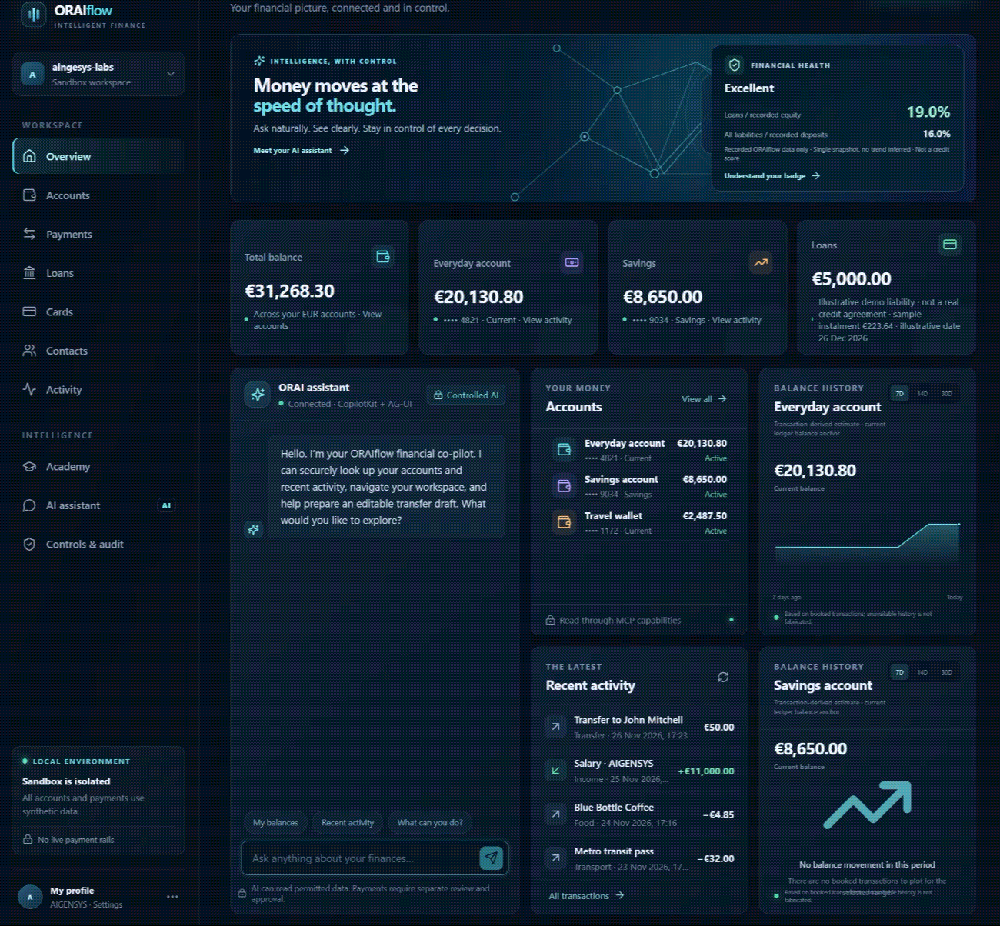

<h1 align="center">


</h1>

<div align="center">

**Intelligent finance. Controlled execution**<br />**End-to-End self-hosted reference framework**
  
  <p>
    <a href="https://www.python.org/downloads/"></a>
    <a href="https://docs.astral.sh/uv/"></a>
    <a href="https://nodejs.org/"></a>
    <a href="LICENSE"></a>
    <br />
    <a href="https://black.readthedocs.io/"></a>
    <a href="https://docs.astral.sh/ruff/"></a>
    <a href="https://fastapi.tiangolo.com/"></a>
    <a href="https://react.dev/"></a>
    <br />
    <a href="https://modelcontextprotocol.io/"></a>
    <a href="https://temporal.io/"></a>
    
  </p>

</div>


<div align="center">

*Synthetic demonstration. Not for use in real financial decisions.*<br />

[](https://github.com/aigensys-labs/oraiflow/blob/main/docs/assets/oraiflow-preview.gif)

</div>

> **DEMO ONLY — ARTIFICIAL DATA — NO FINANCIAL RELIANCE.** ORAIflow Core is a simulated reference framework, not a bank, financial institution, regulated financial service or financial adviser. All identities, accounts, balances, transactions, contacts, loans, risk indicators and payment flows displayed by the sample are artificial and simulated. No live financial institution or payment rail is connected. Nothing in this project is financial, investment, tax or legal advice, a recommendation, or a guarantee. Do not use it to make real financial decisions or transactions, and never enter real personal or financial data. Outputs are not guaranteed accurate or suitable for reliance. See [NOTICE](NOTICE.md), [Synthetic Demo Data Assumptions](docs/DEMO-DATA-ASSUMPTIONS.md) and [Security Boundaries](docs/SECURITY-BOUNDARIES.md).


> **The LLM interprets. OCCF defines permitted operations. MCP exposes authenticated capabilities. The Banking Kernel authorizes consequential commands. Temporal coordinates workflows from the durable PostgreSQL outbox. The synthetic ledger records demo financial truth.**

ORAIflow Core is a local-first reference implementation for agent-assisted financial workflows. It combines a customer workspace, a natural-language assistant, registered capability contracts, read-only banking data access, a separately controlled command boundary and PostgreSQL outbox-backed workflow orchestration.

## What it contains

- **Customer workspace:** React application for overview, deposit accounts, payments, loans, cards, contacts, activity, Academy and audit views. Four selectable, original vector-only banner themes are included as SVG source assets; no raster artwork is shipped.
- **Assistant transport:** CopilotKit Runtime and AG-UI connect the browser to the Agent Runtime.
- **Agent Runtime:** LangGraph-based interpretation, OCCF validation, deterministic task planning and grounded result finalization.
- **Capability boundary:** MCP exposes authenticated, read-only account, transaction, contact, loan-demo and Financial Health reads.
- **Banking Kernel:** FastAPI command boundary validates demo identity, previews, policy and explicit customer confirmation independently of the LLM.
- **Workflow orchestration:** PostgreSQL operational state and the outbox retain accepted work and hand it to the local Temporal development server. Temporal history is disposable when that container is recreated; the current ledger adapter is synthetic PostgreSQL only.

The analytical capability supports filtered, aggregated reads over booked demo records with explicit handling of empty and partial results. The transfer assistant resolves contacts and prepares editable drafts — a draft is not an approval or submitted payment. 
See [Synthetic Demo Data Assumptions](docs/DEMO-DATA-ASSUMPTIONS.md).


## Run the local demo

**Requirements:** Docker Engine or Docker Desktop with Compose v2, Bash (Linux, macOS, WSL or Git Bash), 8 GB RAM recommended, and internet access for the initial image builds.

Clone the published repository, then run the Docker-first setup from its root:

```bash
git clone https://github.com/aigensys-labs/oraiflow.git
cd oraiflow
cp .env.example .env
docker compose up -d --build
docker compose ps
```

The demo runs inside Docker; a host Python, Node.js, PostgreSQL or Temporal installation is not required.

The sample configuration uses `LLM_PROVIDER=demo`, so no external model key is required to start the application. This deterministic demo path is not a semantic-quality test and is not equivalent to a configured model-backed interpreter.

| Service | Local address | Purpose |
|---|---|---|
| Customer workspace | http://localhost:3000 | React application |
| Banking Core API | http://localhost:8000/docs | API and command boundary |
| Agent Runtime | http://localhost:8101/docs | Local diagnostics; internal service |
| Temporal Web UI | http://localhost:8233 | Workflow history |
| API health | http://localhost:8000/healthz | Service health |

Published ports bind to loopback by default. MCP and Copilot Runtime remain internal to the Compose network. Do not widen host bindings or expose the demo to a shared network without adding real authentication, authorization and network controls.

## Connect a model

Set `LLM_PROVIDER` in `.env` to `ollama`, `openai` or `anthropic`, configure the appropriate model and credentials, then rebuild Agent Runtime:

```bash
docker compose up -d --build agent-runtime
```

OpenAI and Anthropic require `LLM_EXTERNAL_DATA_APPROVED=true` before minimized, redacted banking context can be sent to those providers. This is an operator acknowledgement, not a substitute for provider due diligence. A remote Ollama endpoint or private model gateway must also be treated as an external data destination. Review retention, residency, training and subprocessor terms before enabling an external provider. See [Configuration](docs/CONFIGURATION.md).


## Upgrade an existing local demo

1. Back up `.env` and the PostgreSQL `postgres-data` volume.
2. Replace the source tree while retaining `.env`, `certs/` and the existing Compose project/volume identity.
3. Compare `.env.example` with the existing `.env`; do not overwrite local credentials or provider settings.
4. Rebuild and start the services with `docker compose up -d --build`.
5. Confirm migration completion and service health before using the workspace.

**Do not run `docker compose down -v` during an upgrade.** It deletes the persistent PostgreSQL volume. Review [Configuration](docs/CONFIGURATION.md) before changing database, provider or network settings.

## Documentation

Start with the [documentation index](docs/README.md). It links the architecture, interpretation and contract model, analytical capability, transfer boundary, security guidance, local setup, operations and contributor references. Test commands and data-impact notes are in the [test guide](tests/README.md).

## Contributing and support

Use the GitHub issue chooser to report a bug, agent-behavior regression, feature idea, documentation improvement or Docker/demo setup question. Pull requests use the repository's structured pull request template; contribution expectations are in [CONTRIBUTING](CONTRIBUTING.md). Never post real financial information, personal data, secrets or unredacted logs. Security vulnerabilities must be reported privately as described in [SECURITY](SECURITY.md), not through a public issue.

## Licensing

**Functional Source License (FSL 1.1)** with automatic Apache 2.0 grant after 2 years.

- **Permitted**: Internal use, non-commercial education/research, professional services delivery.
- **Restricted**: Building a competing commercial product on top of ORAIflow's core engine.
- **After 2 years**: Automatically converts to **Apache 2.0** (full open source, no restrictions).
- **Not covered**: Trademarks/branding and separately owned IP are not granted by the license.

[Full license → LICENSE](https://github.com/aigensys-labs/oraiflow/blob/main/LICENSE) |
[Learn more → fsl.software](https://fsl.software/)

## Citation

```bibtex
@software{ORAIflow,
  author = {Michal Ricar, PhD},
  year = {2026},
  publisher = {AIGENSYS s.r.o.},
  title = {ORAIflow: Deterministic Agentic Framework for Fintech},
  url = {https://github.com/aigensys-labs/oraiflow}
}
```