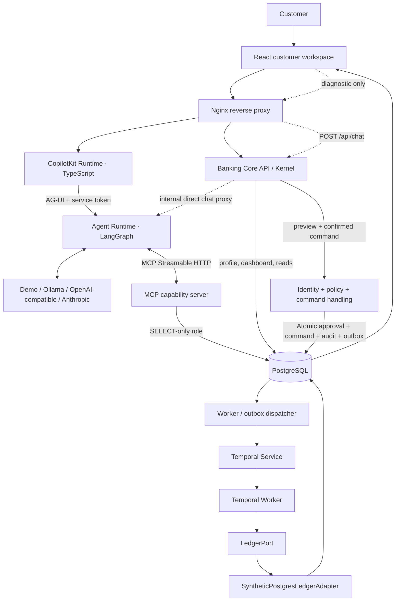

# Architecture and module guide

## Design principle

ORAIflow is a **modular Banking Kernel with an agent-facing experience and outbox-backed workflow orchestration**. The architecture keeps probabilistic interpretation separate from financial authority and avoids creating a separate microservice for every business capability.

> **The LLM interprets. MCP exposes capabilities. The Banking Kernel authorizes. Temporal coordinates workflows. The synthetic ledger determines demo financial truth.**

## Runtime architecture

The solid upper route is the normal customer assistant path. The dotted `/api/chat` route is deliberately retained for read/agent/MCP developer diagnostics and does not synthesize transfer drafts; transfer preparation uses the primary CopilotKit/AG-UI path and Contacts contract. The React UI does not use it for normal chat. Nginx proxies `/api/copilotkit/` to Copilot Runtime and `/api/` to the Banking Core API.

## Components and their added value

| Component | Technology / location | Why it exists | What it contributes |
|---|---|---|---|
| Customer workspace | React + Vite + Nginx (`apps/web`) | Give the customer a real application, not only a chat transcript | Overview, Accounts, Contacts, Activity, Payments, Profile, audit views, transfer review and custom ORAI chat surface |
| CopilotKit React integration | `@copilotkit/react-core` in the browser | Let the app and agent collaborate via a managed lifecycle | Streams turns, shares read-only UI context, registers frontend tools and renders controlled Generative UI components |
| Nginx | `apps/web/nginx.conf` | Keep the browser on one origin and proxy to internal services | Routes `/api/copilotkit/` to Copilot Runtime and `/api/` to Banking Core API; serves the static SPA |
| CopilotKit Runtime | TypeScript (`services/copilot_runtime`) | Provide the browser-facing runtime endpoint | Coordinates CopilotKit requests and forwards agent runs to the Python AG-UI endpoint; scopes local threads to the fixed demo user |
| AG-UI adapter | Python (`services/agent_runtime/agui.py`) | Expose the LangGraph graph through the agent-UI streaming protocol | Streams graph events and returns frontend actions to CopilotKit; the stream adapter suppresses full transcript snapshots while recovering registered current-turn UI/MCP tool events without replaying history |
| Agent Runtime | FastAPI (`services/agent_runtime`) | Isolate model/conversation work from the financial command API | Holds provider credentials, initializes the primary AG-UI graph once per process and calls MCP |
| LangGraph graph | `services/agent_runtime/agent.py` and `agui.py` | Make model/tool control flow explicit | Runs only approved read tools; enforces MCP-before-GenUI for financial display components; validates and binds current-turn MCP data; normalizes connector failures; returns browser actions without financial write authority |
| Model adapters | LangChain provider integrations | Keep the Banking Kernel independent from a specific model vendor | Supports deterministic demo mode, native Ollama, OpenAI-compatible endpoints and Anthropic |
| MCP client | Python MCP SDK (`services/agent_runtime/mcp_client.py`) | Force agent-to-banking reads through a capability protocol | Provides typed MCP calls and no direct Agent Runtime connection to the Banking Core database |
| MCP server | FastMCP / Streamable HTTP (`services/mcp`) | Create a narrow banking data capability surface | Exposes account, transaction, saved-contact and illustrative loan reads using a separate SELECT-only database login |
| Banking Core API | FastAPI (`services/api`) | Keep application and financial authority on a trusted server boundary | Serves profile/workspace data, creates previews, verifies customer confirmation, applies deterministic policy and exposes command/audit status |
| Banking Kernel modules | `shared/identity.py`, `audit.py`, `previews.py`, `money.py`, `banking/` | Keep core financial logic together without premature microservices | Server-derived identity/capabilities, money validation, signed previews, audit evidence and ledger port |
| PostgreSQL | `postgres` Compose service | Persist the local demo state and handoff records | Holds synthetic accounts/transactions, customer contacts, separate illustrative loan liabilities/schedules, profiles, previews, approvals, commands, audit/outbox/reconciliation data and a separate LangGraph checkpoint schema |
| Transactional outbox | PostgreSQL + worker dispatcher | Avoid losing a command if Temporal is temporarily unavailable | Atomically persists a committed command and the intent to start its workflow; dispatcher retries workflow start |
| Temporal | Local Temporal dev service + Python SDK | Own the long-running transfer lifecycle | Stores workflow history while the local container exists, coordinates retries and schedules activities independently of browser connectivity |
| Worker | `services/worker` | Run durable background work outside the API/browser process | Claims outbox rows, starts workflows, executes activities and reconnects/requeues after local Temporal restarts |
| Ledger port and adapter | `shared/banking/ports.py`, `shared/banking/adapters/postgres_ledger.py` | Separate financial workflow logic from the current ledger implementation | The current synthetic adapter books the demo debit and transaction inside a database transaction; a future institution adapter can implement the port |
| Migration/bootstrap | `shared/migrate.py` + `migrate` service | Prepare both fresh and existing databases | Applies additive schema/role setup before MCP, API and worker are started |

## Deployment topology

Compose runs **eight long-running services plus one one-shot bootstrap job**:

| Service | Responsibility | Host exposure |
|---|---|---|
| `web` | React static application and Nginx reverse proxy | `127.0.0.1:3000` |
| `copilot-runtime` | TypeScript CopilotKit Runtime | Internal Docker network only |
| `agent-runtime` | LangGraph, model adapters, MCP client and AG-UI endpoint | `127.0.0.1:8101` for local diagnostics; also internal network |
| `api` | Banking Core API and command boundary | `127.0.0.1:8000` by default; configurable host address/port |
| `mcp` | Read-only MCP banking capabilities | Internal Docker network only |
| `worker` | Outbox dispatcher, Temporal worker and activities | Internal Docker network only |
| `postgres` | Synthetic ledger and operational database | Internal Docker network only |
| `temporal` | Local Temporal dev service and Web UI | `127.0.0.1:7233` and `127.0.0.1:8233` |
| `migrate` | Additive schema and restricted-role bootstrap | No listening port; exits after success |

The backend Python services share `Dockerfile.backend` but run as separate processes with different environment variables and database permissions. Copilot Runtime has its own Node image and web has a Vite-build/Nginx image. Host bindings use loopback to avoid unintentionally publishing local demo interfaces on a LAN. MCP and Copilot Runtime are not published as host ports.

Startup dependencies are deliberate:

1. PostgreSQL becomes healthy before migration runs.
2. MCP, API and worker wait for migration to finish successfully.
3. Agent Runtime waits for MCP; its graph requires the capability server.
4. Copilot Runtime waits for Agent Runtime.
5. Web waits for API and Copilot Runtime.
6. Worker waits for Temporal. API command acceptance does not depend on Temporal being continuously available because the PostgreSQL outbox is the retry source.

## Primary assistant path, step by step

1. The customer enters a message in the ORAI chat component within the React app.
2. CopilotKit React sends the turn to the TypeScript Copilot Runtime through Nginx.
3. Copilot Runtime calls the registered `oraiflow_agent` over AG-UI and a service-to-service token.
4. Agent Runtime runs the LangGraph graph. The AG-UI graph is created once during FastAPI lifespan and uses a PostgreSQL `AsyncPostgresSaver` checkpointer with its restricted database role.
5. For a banking read, LangGraph calls one of its approved MCP tools using the MCP client. MCP independently derives the configured demo identity and queries through the read-only PostgreSQL role.
6. Before `render_account_summary` or `render_transaction_list` can reach the browser, the graph requires a current-turn result from the corresponding MCP read. If the model requests a component first, the graph schedules the required read and invokes the model again only after the tool result is available. Component fields and values are validated, titles are canonicalized and financial props are overwritten from the MCP result.
7. A connector exception becomes a typed `connector_error` result. The graph stops before another model call and returns a customer-safe unavailable message; it does not ask the model to infer missing financial data. Display-only components use CopilotKit `followUp: false`; actual browser actions retain their follow-up behavior.
8. The graph streams assistant events or returns a frontend action. CopilotKit executes registered `useFrontendTool` handlers in the browser and sends action results back in the next AG-UI run.
9. The app accepts only validated/allowlisted frontend actions. Navigation, account selection/filter changes and opening an editable transfer draft are presentation behavior, not financial authorization.

The frontend publishes current workspace and selected-account information through `useAgentContext`. This is read-only presentation context and must never be treated as an identity claim or authorization. Generative UI account/transaction values are bound to schema-validated MCP results from the current turn; model-authored financial values and titles are not the data source of truth. This contract currently protects the registered account and transaction display components, not every possible free-text financial assertion.

The TypeScript runtime uses `InMemoryAgentRunner`, so its runner/route state is process-local. LangGraph checkpoints persist graph state for reused thread IDs, but there is no durable customer-facing thread catalogue or history browser in this release. The runtime is scoped to one fixed demo user, not a production multi-user session model.

## Retained direct API diagnostic path

`POST /api/chat` on the Banking Core API forwards a direct request to Agent Runtime's `/api/chat` endpoint using `AGENT_RUNTIME_INTERNAL_TOKEN`. The customer UI does not call it for normal chat. It remains useful to isolate read/model/agent/MCP behavior from CopilotKit/AG-UI/frontend integration behavior and is exercised by `scripts/smoke.sh`. It does not synthesize transfer drafts or select a source account; those operations use the Contacts-aware CopilotKit flow.

The direct path has no CopilotKit frontend-tool lifecycle. It carries request history in the payload; the primary AG-UI graph/checkpointer path is separate. In direct LLM mode the helper builds its graph for that request, while the normal AG-UI runtime reuses the graph initialized during process startup. Retain this distinction when comparing latency or behavior between the two paths.

## Read-only MCP capabilities

The Agent Runtime exposes seven registered read-only MCP capabilities:

- `list_customer_accounts`
- `get_account_balance(account_id)`
- `get_recent_transactions(limit)`
- `analyze_customer_transactions(...)` — bounded transaction filters, aggregation, grouping and recurring-inflow screening using the authenticated read scope
- `search_contacts(name_query)` — searches only the authenticated customer’s saved contacts and returns name, bank, masked account reference, currency and status; email and phone are excluded from the model-facing result.
- `get_customer_loan_overview` — returns illustrative loan terms/repayment data only when `DEMO_LOAN_ENABLED=true`; it is disabled by default and must not be described as a verified real credit agreement.
- `get_customer_financial_health_overview` — returns the registered recorded-leverage indicator, not a credit-bureau score.

The interpretation model is not given executable MCP tools during the assessment call; the Agent Runtime maps validated intents to registered operations and invokes the MCP client. The MCP tools derive the local demo customer from server configuration; the model cannot pass a customer or tenant identity. MCP uses `oraiflow_mcp_reader`, which has `SELECT` on `accounts`, `transactions`, `contacts`, `demo_loans` and `demo_loan_installments` only. Contact records are synthetic demo beneficiaries and their masked references do not prove the existence or ownership of a live external bank account. Agent Runtime does not receive the Banking Core `DATABASE_URL`; the checkpoint connection is restricted to `oraiflow_agent`.

## Financial command and transfer lifecycle

The agent has no preview, approval, transfer-confirmation or financial write tool. A transfer is committed through the separate customer application and Kernel API:

1. For chat-initiated beneficiary selection, Agent Runtime searches Contacts through MCP. A unique match is bound to the draft; multiple matches require an explicit customer choice. The source account must be selected in the workspace or named explicitly; the agent never defaults to the first account.
2. The agent proposal may prefill an editable UI draft with the canonical `beneficiary_contact_id`. It is untrusted presentation state.
3. The customer reviews/edits the form and requests a preview from the Banking Core API.
4. The Kernel derives demo identity/tenant, rechecks contact ownership/status and canonical name when a contact ID is supplied, validates account ownership and policy, then persists an expiring Action Preview.
5. The preview stores the exact normalized payload—including the beneficiary contact ID—and an HMAC-protected digest/policy context.
6. The customer reviews the displayed details and explicitly confirms the preview and demo challenge.
7. The API reloads the stored preview, verifies digest, ownership, contact binding, expiry and single-use status, then revalidates policy under database locking.
8. Approval, command, hash-linked audit events and outbox event are committed atomically in PostgreSQL.
9. The worker claims the outbox event and starts a Temporal workflow with a stable workflow ID.
10. A Temporal activity invokes `LedgerPort`; `SyntheticPostgresLedgerAdapter` debits the synthetic account, books the transfer transaction and records reconciliation in one PostgreSQL transaction.
11. The UI polls command status. After settlement, the assistant can read the booked transaction through MCP.

The normal command lifecycle is `PENDING` → `EXECUTING` → `SETTLED`. A deterministic local rejection becomes `FAILED`. An outcome that remains uncertain after automatic retries becomes `REQUIRES_RECONCILIATION`; the UI warns against duplicate submission. Temporal retries do not provide exactly-once semantics for a future external rail: a real institution adapter must provide downstream idempotency and reconciliation.

## Data and persistence

| Data | Location | Persistence |
|---|---|---|
| Synthetic ledger, Contacts catalogue and Banking Core state | PostgreSQL `postgres-data` volume | Persists across container restarts and normal `docker compose down` |
| LangGraph checkpoints | PostgreSQL schema `oraiflow_agent` | Persisted by the restricted checkpoint role |
| MCP reads | PostgreSQL role `oraiflow_mcp_reader` | SELECT-only on accounts, transactions, contacts and illustrative loan tables |
| Temporal development history | `/tmp/temporal.db` inside Temporal container | Disposable when the Temporal container is recreated |
| Theme, font size, density, default page, reduced motion, banner artwork and banner visibility | Browser local storage | Browser-local presentation settings; banner hidden by default |
| Personal profile values | PostgreSQL `customer_profiles` | Server-stored under immutable demo user/tenant IDs |

Do not use `docker compose down -v` as a normal stop or upgrade command; it removes the PostgreSQL named volume.

## Deliberate limitations

- Identity is a fixed local demo user/tenant; there is no OIDC login or production tenant resolution.
- MCP/service tokens are static development bearer tokens, not OAuth 2.1 authorization.
- The visible confirmation challenge is not real SCA.
- All banking data is synthetic; no live bank adapter, core banking connection or payment rail exists.
- Contacts are synthetic saved beneficiaries for local contract testing, not verified external payees. Cards is a UI preview only; card servicing/transactions are not implemented.
- Temporal is the local development server with disposable history, not a production deployment.
- Audit events are trigger-protected and hash-linked, but not an independent WORM archive.
- Model data redaction is a baseline, not complete DLP or prompt-injection protection.

See [Security boundaries](SECURITY-BOUNDARIES.md) before connecting external systems.

## Universal capability contract framework

The ORAIflow Capability Contract Framework (OCCF) is the canonical contract boundary for every agent-facing MCP tool, frontend action and GenUI renderer, plus separately declared Banking Kernel operations. The language-neutral source is `shared/contracts/registry.json`; Python validates against it and TypeScript/Zod validators are generated from it. The registry separates intents (what the customer wants), capabilities (bounded operations), presentations (approved renderers) and Kernel operations (authoritative financial APIs).

Every capability follows the same lifecycle: resolve → validate input → establish trusted context → check preconditions → execute under declared effect/timeout/retry semantics → validate output → attach provenance/scope/freshness and trace evidence → resolve presentation → complete. MCP and frontend capabilities return a standard versioned result envelope with distinct `SUCCESS`, `EMPTY`, `PARTIAL`, `INVALID_INPUT`, `REJECTED`, `UNAVAILABLE` and `INVALID_RESPONSE` outcomes. Kernel operations have their own typed HTTP request/response contracts and remain explicitly non-agent-callable.

Registry loading checks schema validity and cross-references. Automated conformance tests verify that every declared MCP tool, frontend action, presentation renderer and Kernel route exists in source. A capability cannot be added only by writing a tool function: its schemas, authorization declaration, effects, retry semantics, evidence, failure message, presentation/intent links and tests must also be registered.

This framework does not grant authorization or prove source truth. MCP still derives identity and enforces read capability; frontend handlers enforce application allowlists; the Banking Kernel independently enforces financial policy, customer approval and command rules. The current source registry and lifecycle are explained in [Capability Contracts](CAPABILITY-CONTRACTS.md).
